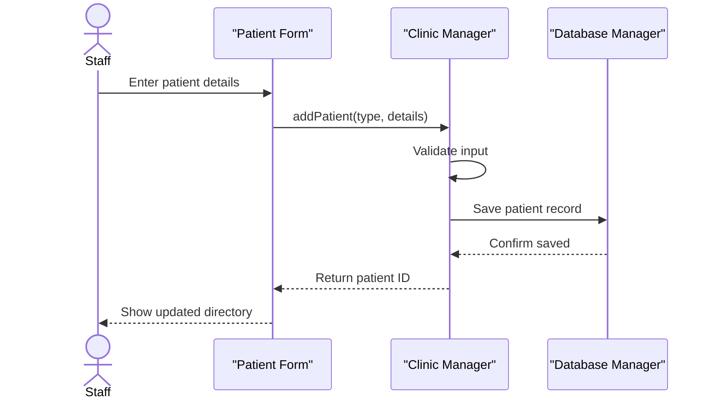
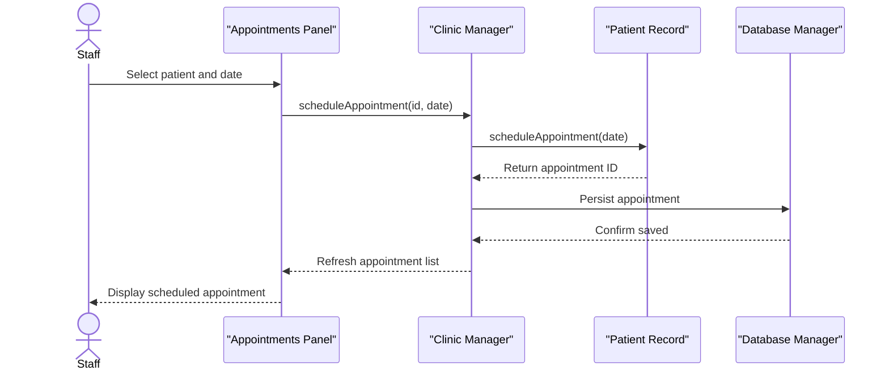
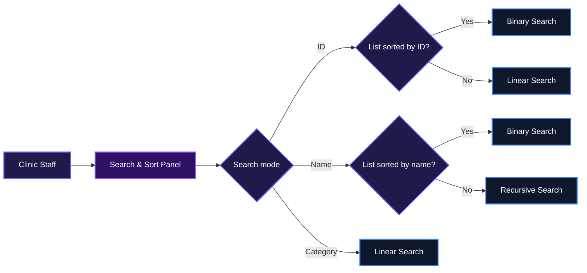

# SCAPMS - Smart Clinic Appointment & Patient Management System

SCAPMS gives small clinic staff a single desktop workspace for registering patients, booking appointments, and managing a real-time waiting queue. Staff can track patient categories, undo accidental changes, search and sort records, and export data without juggling spreadsheets. It turns daily clinic operations into a calm, organized workflow.

## System Architecture

The application is built around a clean separation between the Qt-based desktop interface, a central controller for business logic, and a SQLite persistence layer. Patient records, appointments, and the waiting queue live in memory during use and are written to a local database on demand.


## Features

- **Patient registration and management**
  Register patients under General, Emergency, or FollowUp categories. Each category carries its own validation rules. For example, follow-up appointments cannot be scheduled before the previous visit date, and emergency cases are highlighted in red.



- **Appointment scheduling and tracking**
  Book, complete, or cancel appointments with clear status tracking. Past dates trigger a warning, and cancelled appointments stay visible with strikethrough formatting.



- **Smart search and sorting**
  Search by patient ID, name, or category. The system picks the fastest algorithm based on the current sort state, and staff can sort records with selection or merge sort.



- **Real-time waiting queue**
  Add patients to a live queue, call the next person, and get alerts when someone has waited longer than a configured threshold.

- **Reports and analytics dashboard**
  View patient counts, appointment summaries, category distribution, and today's reminders from a central dashboard that refreshes automatically.

- **Undo and data portability**
  Reverse deletes, edits, or cancellations from an undo stack. Save to SQLite, import or export SCAPMS-formatted CSV files, or start a fresh database.

## Installation

### 1. Clone the repository

```bash
git clone https://github.com/mbazuvictor/cos-202-scamps.git
cd cos-202-scamps
```

### 2. Install dependencies (Ubuntu / Debian)

```bash
sudo apt update
sudo apt install build-essential cmake qt6-base-dev libsqlite3-dev
```

Qt 5 is also supported if Qt 6 is not available.

### 3. Build the project

```bash
cmake -S . -B build
cmake --build build
```

### 4. Run

```bash
./build/scapms
```

The app creates `scapms.db` in the working directory on first launch.

## Usage

When you open SCAPMS, you land on a welcome screen. Click **Enter clinic workspace** to open the main tabs.

Common workflows:

- **Add a patient**: go to the Patients tab, click **Add patient**, fill the form, and save.
- **Schedule an appointment**: go to the Appointments tab, select a patient, pick a date, and click **Schedule appointment**.
- **Manage the queue**: go to the Queue tab, add patients to the queue, then click **Call next patient**.
- **Search or sort records**: use the search box and sort controls to find patients quickly.
- **Undo a mistake**: press `Ctrl+Z` or use Edit > Undo to reverse the last delete or edit.

Keyboard shortcuts:

- `Ctrl+N`: New database
- `Ctrl+S`: Save
- `Ctrl+L`: Load
- `Ctrl+F`: Search
- `Ctrl+I` / `Ctrl+E`: Import / export a CSV file
- `Ctrl+Shift+N`: Add patient
- `Ctrl+Z`: Undo
- `Ctrl+Q`: Exit

## Technologies Used

| Technology | Purpose |
|------------|---------|
| [C++17](https://isocpp.org/) | Core application language |
| [Qt Widgets](https://www.qt.io/) | Desktop GUI framework |
| [SQLite3](https://www.sqlite.org/) | Local data storage |
| [CMake](https://cmake.org/) | Build system |

## Author Info

Built by **Mbazu Onyedikachi Victor**.

## Badges

[](https://isocpp.org/)
[](https://www.qt.io/)
[](https://www.sqlite.org/)
[](https://cmake.org/)

[](https://dokugen.samueltuoyo.com)